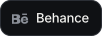
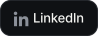
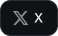
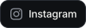

<!--
  EMRE ERIM — github profile · v07 bento
  ──────────────────────────────────────────────────
  Designer + Engineer · Konya
  bento grid · light + dark aware · chartreuse #C7F551
  no emojis · no badges · no shields
-->

<picture>
  <source media="(prefers-color-scheme: dark)" srcset="assets/bento-dark.svg">
  <source media="(prefers-color-scheme: light)" srcset="assets/bento-light.svg">
  
</picture>

  <a href="https://erim.digital">
    <picture>
      <source media="(prefers-color-scheme: dark)" srcset="assets/social/site-dark.svg">
      <source media="(prefers-color-scheme: light)" srcset="assets/social/site-light.svg">
      
    </picture>
  </a>
  &nbsp;
  <a href="https://www.behance.net/emreerim">
    <picture>
      <source media="(prefers-color-scheme: dark)" srcset="assets/social/behance-dark.svg">
      <source media="(prefers-color-scheme: light)" srcset="assets/social/behance-light.svg">
      
    </picture>
  </a>
  &nbsp;
  <a href="https://linkedin.com/in/emreeerm">
    <picture>
      <source media="(prefers-color-scheme: dark)" srcset="assets/social/linkedin-dark.svg">
      <source media="(prefers-color-scheme: light)" srcset="assets/social/linkedin-light.svg">
      
    </picture>
  </a>
  &nbsp;
  <a href="https://x.com/emreeerm">
    <picture>
      <source media="(prefers-color-scheme: dark)" srcset="assets/social/x-dark.svg">
      <source media="(prefers-color-scheme: light)" srcset="assets/social/x-light.svg">
      
    </picture>
  </a>
  &nbsp;
  <a href="https://instagram.com/emreeerm">
    <picture>
      <source media="(prefers-color-scheme: dark)" srcset="assets/social/instagram-dark.svg">
      <source media="(prefers-color-scheme: light)" srcset="assets/social/instagram-light.svg">
      
    </picture>
  </a>
  &nbsp;
  <a href="mailto:emre.uiux@gmail.com">
    <picture>
      <source media="(prefers-color-scheme: dark)" srcset="assets/social/mail-dark.svg">
      <source media="(prefers-color-scheme: light)" srcset="assets/social/mail-light.svg">
      
    </picture>
  </a>

 

  <picture>
    <source media="(prefers-color-scheme: dark)" srcset="https://streak-stats.demolab.com/?user=Emreerm&hide_border=true&border_radius=22&background=0F1114&stroke=23262B&ring=C7F551&fire=C7F551&currStreakNum=F5F5F2&sideNums=F5F5F2&currStreakLabel=C7F551&sideLabels=8B9099&dates=8B9099&excludeDaysLabel=8B9099">
    <source media="(prefers-color-scheme: light)" srcset="https://streak-stats.demolab.com/?user=Emreerm&hide_border=false&border=E4E4DF&border_radius=22&background=FFFFFF&stroke=E4E4DF&ring=8DB21A&fire=8DB21A&currStreakNum=0B0B0C&sideNums=0B0B0C&currStreakLabel=0B0B0C&sideLabels=62666D&dates=62666D&excludeDaysLabel=62666D">
    
  </picture>

  MMXXVI · Konya · designed &amp; built by hand

<!--
  colophon
  ──────────────────────────────────────────────────
  two SVGs (assets/bento-dark.svg, assets/bento-light.svg) swapped via <picture>
  + prefers-color-scheme, so the card matches the reader's GitHub theme.
  cards float on GitHub's own background (no outer fill). system sans stack
  (Inter → SF → Segoe) because SVG-in- can't load web fonts; the accent
  period is a <tspan> so it tracks the name on any fallback font.
  staggered rise-in ~0.9s, pulsing status dot, orbiting location marker —
  all disabled under prefers-reduced-motion.
  social navigation built as theme-aware vector chips with optical kerning
  and chartreuse signature CTA.
  v01 banner · v02 hud · v03 system · v04 riso press · v05 studio · v06 ascii boot · v07 bento
-->
